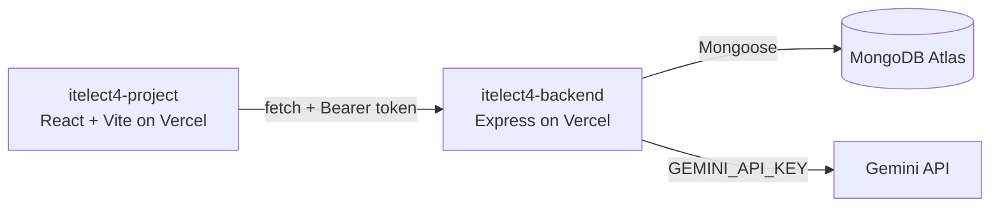

# Peer Tutoring Booking Platform

[](https://github.com/leemuelgarcia/itelect4-project/actions/workflows/ci.yml)

A React and TypeScript web application for browsing tutoring sessions and managing tutoring bookings.

This project was developed for ITELECT4 and demonstrates TypeScript, React routing, state management, API data fetching, form validation, and reusable UI components.

## Live deployment

- Live frontend: https://itelect4-project-gamma.vercel.app
- Live backend API: https://itelect4-backend-sable.vercel.app
- Backend health check: https://itelect4-backend-sable.vercel.app/api/health
- Backend repository: https://github.com/leemuelgarcia/itelect4-backend

## Architecture



The browser only ever talks to the backend. The Gemini key lives on the server and is never sent to the browser.

## Features

- User login with protected routes
- Browse available tutoring sessions
- View individual tutoring session details
- Search tutoring sessions
- Create tutoring bookings
- View booking status
- Add a learning goal when booking a session
- AI Coach: describe what you want to learn and get a clarity rating, a summary, topics and preparation steps from Gemini
- Form validation with visible error messages
- Persistent authentication state
- Persistent dark mode preference
- REST API served by the Express and MongoDB backend
- Typed API queries and mutations
- Responsive user interface

## Technologies Used

- React
- TypeScript
- Vite
- React Router
- Zustand
- TanStack Query
- Express, Mongoose and MongoDB Atlas (separate backend repository)
- React Hook Form
- Zod
- Shadcn UI
- Tailwind CSS

## Getting Started

### 1. Install dependencies

```bash
npm install
```

### 2. Configure the API address

The frontend talks to the backend API through the `VITE_API_URL` environment variable. Copy the example file, then set the value to the backend's address, with no trailing slash and no `/api` on the end:

```bash
cp .env.example .env
```

For the deployed backend, use `https://itelect4-backend-sable.vercel.app`. Restart `npm run dev` after changing `.env`.

### 3. Start the frontend

Open a second terminal and run:

```bash
npm run dev
```

Open the local Vite URL shown in the terminal, normally:

```text
http://localhost:5173
```

## Login

Create an account on the Register page, or sign in on the Login page. The backend signs a token on login, and the frontend sends it as a Bearer header on private requests. Authentication state is managed with Zustand and persisted in browser storage.

## Main Pages

### Dashboard

Displays an overview of the tutoring platform and booking information.

### Sessions

Displays tutoring sessions retrieved from the backend API.

Users can search through the available sessions and open an individual session page.

### Session Details

Displays information for a specific tutoring session using a route parameter.

### Bookings

Displays the current user's bookings and provides a form for creating a new booking.

The booking form requires:

- A tutoring session
- A learning goal between 10 and 200 characters
- A valid positive session ID

Invalid form submissions display validation messages and do not send a POST request to the API.

### AI Coach

A private page where a student describes what they want to learn and gets feedback from Gemini through the backend's `POST /api/ai`: a clarity rating, a summary, topics to focus on and steps to prepare. The form is validated with React Hook Form and Zod, the request goes through `useMutation`, and the browser never talks to Gemini directly.

## State Management

The project uses Zustand for application state.

The authentication store persists the user's authentication token.

A separate UI store manages interface state such as dark mode and session search.

## Data Fetching

TanStack Query is used for API data fetching and caching.

The application uses typed queries for tutoring sessions and bookings.

Creating a booking uses a mutation that sends an authenticated POST request to the backend API and invalidates the bookings query after a successful request.

All API requests are centralized in:

```text
src/api/client.ts
```

## Form Validation

The booking form uses:

- React Hook Form
- Zod
- `@hookform/resolvers`

The booking validation schema is located in:

```text
src/schemas/bookingSchema.ts
```

The form's TypeScript values are derived directly from the Zod schema using `z.infer`.

## UI Components

Shadcn UI components are stored inside the project under:

```text
src/components/ui/
```

The project currently uses reusable:

- Button
- Input
- Label

components across multiple pages.

## Tests

```bash
npm test
```

Vitest runs in a pretend browser page (jsdom) with Testing Library: `SessionCard.test.tsx` checks the exact text a session card shows, `useToggle.test.ts` checks a hook's starting value and that it flips inside `act()`, and `ReviewPage.test.tsx` checks the AI Coach form refuses a too-short description with the schema's exact message and sends no request. GitHub Actions (`.github/workflows/ci.yml`) runs lint, the tests and the build on every push.

## Production Build

To verify that the project compiles with TypeScript and builds successfully, run:

```bash
npm run build
```

The build should finish with zero TypeScript errors.

## Project Structure

```text
src/
├── api/
│   └── client.ts
├── components/
│   ├── ui/
│   └── ...
├── data/
├── pages/
├── schemas/
│   └── bookingSchema.ts
├── store/
├── types/
│   └── index.ts
├── App.tsx
└── main.tsx
```

## GT3 Implementation

### Part 1 — Routing and Navigation

Implemented routed pages, a shared layout, protected routes, URL parameters, navigation, and authentication-based route protection.

### Part 2 — State Management and Data Fetching

Implemented persisted Zustand stores, JSON Server, typed TanStack Query queries, API caching, and booking mutations.

### Part 3 — Forms and UI Components

Implemented React Hook Form, Zod validation, schema-derived TypeScript types, custom `.refine()` validation, Shadcn UI components, and validated booking submissions.

## Repository

This repository contains the frontend implementation of the Peer Tutoring Booking Platform for ITELECT4.

## AI-use disclosure

I used an AI assistant (Claude, by Anthropic) while building this project. It helped write and explain code, tests, the CI workflow and this README across the GT4 to GT6 work. I ran, tested and deployed everything myself. The app also calls Google's Gemini model at runtime, through the backend's `POST /api/ai`.
